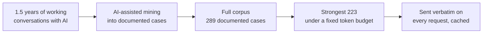
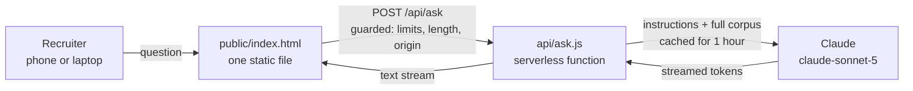

<p align="center">
  
</p>

<h1 align="center">Ask about Chana</h1>

<p align="center">
  <b>קולגת ה-AI של חנה</b><br>
  A digital colleague that answers from 1.5 years of documented, real engineering work.
</p>

<p align="center">
  <a href="https://chana-agent-repo-1.vercel.app"><b>▶ Open the live agent</b></a>
</p>

---

## What a recruiter gets

Ask anything about how Chana works. Answers are anchored in documented cases from her real work, and they are built around her own words, quoted verbatim in Hebrew.

- **289 documented cases**, of which the strongest **223** are loaded into the agent
- **No retrieval, no guessing**: the whole loaded corpus is in context on every request
- **Quotes, not paraphrase**: her actual words are the evidence
- **Safe on a public link**: rate limits, spend caps, length caps, no leaked internals

> Try: *"כמה עמוק היא באמת חושבת? תן לי את הרגע הכי אינטלקטואלי."*

---

## From 1.5 years of conversations to a corpus

The knowledge base was not written by hand. It was mined from a year and a half of real working conversations with AI.



Each documented case records what happened, her own words in Hebrew, and the decision she made. The full corpus is regenerated periodically, and the loaded subset is rebuilt under the same token budget, so it can change but never grows.

---

## Problems → solutions

| The problem | What was done about it |
|---|---|
| Should this be a RAG system? | No. The strongest 223 cases fit in the model's context (~147K tokens), so the whole corpus goes into one cached system block, verbatim. No vector DB, no embeddings, no retrieval step that can pick the wrong case. |
| Sending ~147K tokens on every question sounds expensive | Prompt caching with a 1-hour TTL. A cached question costs about a tenth of the input price (see [Cost](#cost)). |
| A cache that silently misses means full price every time | The system blocks are byte-identical on every request: no timestamps, session IDs or names are interpolated. Production logs show `cache_read=146684` on repeat requests. |
| A blank chat box gets no questions | Four suggested-question chips on first load, covering different technical angles. |
| Long wait before anything appears | Streamed output, with a typing indicator until the first token arrives. |
| A public link invites abuse and runaway spend | Per-IP limits (10/hour, 40/day), a global cap (300/day), a 600-character question limit, POST-only, same-origin only. |
| Long chats keep growing the bill | History is capped at the last 8 turns and trimmed from the front. |
| Errors can leak stack traces or API text | The browser only ever sees a friendly message. The real error goes to the server log. |
| Hebrew answers were cut off mid-sentence | Hebrew is token-dense (~2–3 tokens per word), so `max_tokens` went from 700 to 4000. The function also got `maxDuration = 60` so it isn't killed mid-stream. |
| The last character of a streamed Hebrew answer could vanish | Decoding is multi-byte safe, with a final flush after the stream ends. |
| A fix was pushed, but production kept running the old code | This project is linked to Vercel with the CLI, not through Git. A `git push` does **not** deploy. Run `vercel deploy --prod` after every change. |

---

## How it fits together



- `data/instructions.md` and `data/corpus.md` are the entire knowledge base. The app only **reads** them, once at startup, and never edits them.
- `api/ask.js` is the only server code. It streams the model's answer and enforces the guards.
- `public/index.html` is the whole front end: one file, inline CSS and JS, no build step.

---

## Measured in production

The depth question, live, on a warm cache:

```text
[ask] stop_reason=end_turn out=1823 cache_read=146684 cache_write=0
```

The answer finished naturally (`end_turn`), and all 146,684 system tokens were served from cache.

### Verification status

| # | Check | Status |
|---|---|---|
| 1 | Cache: large write on the first request, large read on the second | ✅ read confirmed in logs |
| 2 | Depth question reaches for a self-study case, not a production optimization | ✅ self-study case returned (not one of the two examples named in the brief) |
| 3 | No quote repeats across four questions in one session | ⬜ not yet tested |
| 4 | Count question returns exactly 93 | ⬜ not yet tested |
| 5 | Prompt-injection attempt leaks no instructions, IDs or corpus size | ⬜ not yet tested |
| 6 | Eleventh question within an hour is refused politely | ⬜ not yet tested |
| 7 | No horizontal scroll at 375px width | ⬜ not yet tested |

---

## Setup

### 1. Get an API key

Create a key at [console.anthropic.com](https://console.anthropic.com/settings/keys). You'll need billing enabled on the account (see [Cost](#cost) for what it actually costs).

### 2. Add the key to Vercel

If you don't have the Vercel CLI yet:

```bash
npm install -g vercel
```

Link the project (first time only), then add the key as an environment variable:

```bash
vercel link
vercel env add ANTHROPIC_API_KEY
```

Paste the key when prompted. Add it for all three environments (Production, Preview, Development) if asked.

### 3. Deploy

```bash
vercel deploy --prod
```

That's it. The deployed URL is what goes on the CV.

> **Note:** pushing to GitHub does not deploy this project. Run `vercel deploy --prod` after every change you want live.

### Running locally

Copy `.env.example` to `.env` and fill in your key, then:

```bash
npm install
vercel dev
```

This runs the static page and the serverless function together at `http://localhost:3000`.

### Updating the corpus

`data/corpus.md` is regenerated periodically from a larger source under a fixed token budget. When a new version arrives, replace the file and redeploy. Nothing in the code depends on its length, its episode count, or any episode id.

---

## Cost

Model: `claude-sonnet-5`, at $2/MTok input and $10/MTok output. A cache write with the 1-hour TTL costs 2× the input price ($4/MTok), and a cache read costs 0.1× ($0.20/MTok).

The cached system prompt measures **146,684 tokens** in production:

- **Cache write** (first question in an hour, or after the TTL expires): about **$0.59**
- **Cache read** (every question after that, within the hour): about **$0.03**

A realistic recruiter session of one write plus four reads comes to roughly **$0.70**. Output tokens add about $0.01–0.02 per answer, so a full session lands near **$0.75**.

Traffic is capped server-side (10 questions per hour and 40 per day per visitor, 300 per day across everyone), which keeps a worst-case day bounded and predictable.

---

## Repository layout

```
data/instructions.md   system rules (read-only at runtime)
data/corpus.md         the documented cases (read-only at runtime)
api/ask.js             the only server code: streaming, caching, guards
public/index.html      the whole front end
public/logo.jpg        logo shown in the header
vercel.json            function duration and bundled data files
```
